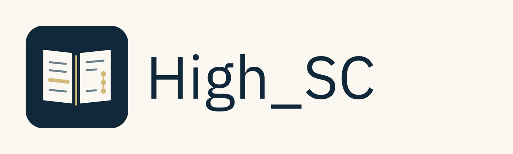
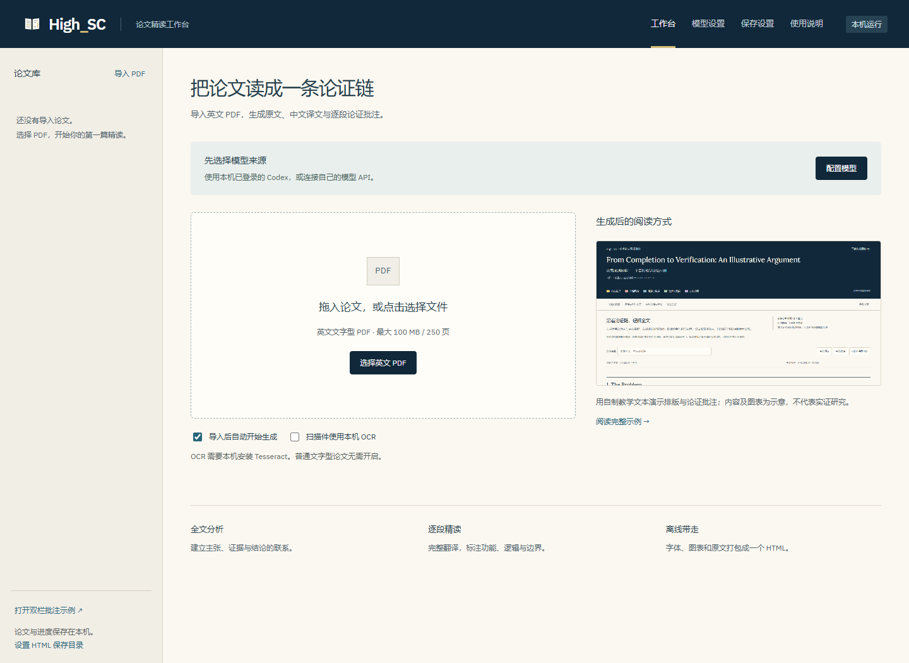

# High_SC



**将英文论文 PDF 生成英中对照、逐段论证批注的离线 HTML。**

A local academic reading workbench: English–Chinese translation, grounded highlights, and paragraph-level argument analysis in a single self-contained HTML file.



High_SC 在本机解析和保存论文，调用你选择的大模型完成翻译与分析。支持官方 API、兼容协议的第三方渠道、本地模型服务，以及复用 ChatGPT 登录的本机 Codex CLI。

## 阅读效果

- 左栏依次呈现英文原文和中文意译，译文使用浅米色背景，与原文清晰区分。
- 右栏逐段说明**段落功能、逻辑角色、论证技巧或潜在漏洞**。
- 五色高亮：黄色论点、红色术语、蓝色证据、绿色让步与反驳、紫色方法。高亮必须匹配英文原文。
- 全文先建立论证骨架，再生成逐段批注；底部汇总“问题 → 论点 → 证据 → 反驳 → 结论”、一句话主张及最强和最弱之处。
- 内嵌图表、字体和原始 PDF，单个 HTML 可离线阅读；支持章节跳转、搜索、图表放大、打印和手机单栏。

下载项目后可直接打开 [examples/demo.html](examples/demo.html)，无需模型或密钥。该示例使用项目自制的教学文本，全部内容和论证均为示意；不包含他人的论文或实验结果。

## 快速开始

### Windows EXE（无需 Python）

从 [Release](https://github.com/andijues/High_SC/releases/latest) 下载 Windows x64 EXE 或 ZIP，双击 EXE 即可打开工作台。右键系统托盘图标可打开目录或退出程序。模型 API 需自行配置；Codex 模式仍需本机安装并登录官方 CLI。

顶部“保存设置”可独立选择 HTML 目录，并开启自动保存；生成后也可手动点击“保存到指定目录”。同名结果会编号，保留已有文件。“浏览器下载”使用浏览器自身的目录设置。

使用、数据位置与构建说明见 [Windows 指南](docs/windows.md)。

### Windows 源码运行

需要 **Python 3.11+**，推荐 3.11 或更新版本。首次安装需要网络。

1. 下载本仓库 ZIP 并解压，或 `git clone https://github.com/andijues/High_SC.git`。
2. 双击 **启动 High_SC.cmd**。首次运行会创建 `.venv` 并安装依赖。
3. 在浏览器的**模型设置**中选择调用方式，填写配置，测试后保存。
4. 导入英文 PDF，等待分阶段生成，再预览或下载 HTML。

默认地址为 `http://127.0.0.1:8693`；端口占用时启动器会选择其他本机端口。需要重新安装依赖时运行 **安装或修复.cmd**，关闭后台服务时运行 **停止 High_SC.cmd**。

### 命令行 / macOS / Linux

```bash
git clone https://github.com/andijues/High_SC.git
cd High_SC
python -m venv .venv
# macOS / Linux
source .venv/bin/activate
# Windows PowerShell 使用：.venv\Scripts\Activate.ps1
python -m pip install -r requirements.lock.txt
python run.py
```

浏览器访问 `http://127.0.0.1:8693`。命令行服务使用 `Ctrl+C` 关闭。Windows 启动器已经过本机验证；其他平台由自动化测试覆盖核心流程，具体桌面环境仍可能需要调整。

## 模型与接口

| 调用方式 | 配置重点 | 认证 |
|---|---|---|
| 本机 Codex | 安装官方 Codex CLI，使用 ChatGPT 登录，填写可用模型 ID | CLI 管理登录，无需另填 API Key |
| Chat Completions | 官方或第三方兼容 `/chat/completions` 的接口 | 默认 Bearer，可调整 |
| Responses | 兼容 `/responses` 的接口 | 默认 Bearer，可调整 |
| Anthropic Messages | 兼容 `/messages` 的接口 | 默认 `x-api-key` |
| 本地模型 / 网关 | 选择其实际实现的上述协议，填本地地址和模型 ID | 可选择无认证 |

第三方服务应选择其**实际实现的协议**，不能仅根据模型名称判断。模型 ID 按渠道文档填写，不会自动映射或降级。

兼容设置提供：

- 基础地址自动拼接路径，或完整网关地址原样使用；支持 `api-version` 等非敏感查询参数。
- Bearer、`x-api-key`、`api-key`、无自动认证，以及自定义请求头。
- 输出字段 `max_tokens` / `max_completion_tokens` / `max_output_tokens` 或不发送。
- 可选原生 JSON 模式、可选 temperature、额外请求体 JSON、超时、重试和 HTTP 代理。
- 自定义头可用 `${API_KEY}` 引用密钥；Windows 下与密钥一样加密保存，不回显到网页或导出文件。

完整配置示例、协议差异与排错见 [API 接入指南](docs/api-providers.md)。这覆盖常见兼容网关；不含任意厂商专有协议、云厂商签名、流式专用接口或 OAuth 网关登录。

### 本机 Codex

先安装并登录[官方 Codex CLI](https://developers.openai.com/codex/cli/)，确认：

```bash
codex login
codex login status
```

在 High_SC 中选择**本机 Codex**，填写账号可用的模型名与推理强度。程序通过官方 `codex exec` 发起受限、只读的文本分析任务，不读取或复制登录令牌。可指定 Codex 程序路径。

本机已验证的组合为 `gpt-6.1-sol` + `xhigh`；其他账号、CLI 版本和服务端支持可能不同。该模式使用 Codex 用量，不等同于普通 OpenAI API。ChatGPT 订阅与 API 计费的关系以[官方说明](https://help.openai.com/en/articles/9039756-managing-billing-for-chatgpt-and-the-api-platform)为准，项目不承诺无限额度或免费 API。

## 暂停、恢复与校对

处理分为：**解析 PDF → 全文骨架 → 逐段翻译批注 → 图表说明 → 检查与打包**。长文会先生成分块摘要。

已完成段落保存在本机。失败后修正配置并继续，程序会复用缓存；单段重做仅处理所选段落。Codex 模式暂停时停止当前 CLI 请求，HTTP API 模式在当前请求返回后暂停。关闭浏览器不停止后台服务。

在“段落校对”中可编辑译文、批注和高亮。修改后点击“更新 HTML”。数字和统计限定语提示用于辅助核对，不是准确性判定。

## 数据与隐私

- 原始 PDF、解析内容、生成进度和导出结果位于 `data/papers/<论文编号>/`；配置位于 `data/settings.json`。EXE 版的数据根目录为 `%LOCALAPPDATA%/High_SC/`，源码版为项目下的 `data/`；HTML 输出目录独立设置。
- Windows 使用当前账户的 DPAPI 加密密钥和自定义请求头。其他平台采用权限为 `0600` 的本地配置，**不提供系统级加密**。不要把配置交给他人。
- 调用模型时，提取的论文文本、图表文字和上下文会发送到你配置的服务。请自行确认渠道可信度及其数据处理规则。
- 导出 HTML 包含原始 PDF。分享前应确认原论文的分享权限。
- 服务仅监听本机，带有请求来源和会话校验；不是供公网部署的多人服务。
- `data/`、日志、密钥、本地测试产物及私人论文均被 Git 忽略。本仓库不包含登录令牌或用户论文。

备份对应的数据目录可保留任务；Windows 密钥绑定当前账户，换机器或用户后请重新填写。升级程序时保留 `data/`，重新安装依赖，并先暂停正在处理的任务。

## 支持范围

优先支持可选择文字的英文论文，限制 100 MB / 250 页。扫描件需另外安装 Tesseract 并在导入时开启 OCR。复杂跨栏、数学公式、特殊字体和不规则表格可能需要人工核对。

图表以裁切原图保存。当前模型基于图题、可提取文字和全文上下文生成说明，**不发送图像像素**。不要将图表说明视为经过视觉模型验证的数据提取。

程序检查漏段、高亮定位及部分数值差异；模型对论证的评价仍需读者判断。论文文本作为待分析资料处理，不作为软件执行指令。

## 开发与验证

无前端构建步骤。后端 Python / FastAPI，前端原生 HTML、CSS、JavaScript，PDF 使用 PyMuPDF。结构见 [架构说明](docs/architecture.md)。

```bash
python -m unittest discover -s tests -v
python scripts/build_demo.py
```

核心测试使用本地模拟服务，不需要 API Key，也不会产生模型费用，覆盖三种协议、第三方认证和路由、敏感配置、完整生成与编辑导出、失败恢复及 Codex 调度。可选浏览器测试和验证边界见 [测试说明](docs/testing.md)。

## 参与和许可

欢迎提交问题和改进，见 [CONTRIBUTING.md](CONTRIBUTING.md)。安全问题见 [SECURITY.md](SECURITY.md)。

软件源码采用 [GNU AGPL v3](LICENSE)，第三方字体遵循 SIL OFL 1.1。PyMuPDF 采用 AGPL / 商业双重许可，本项目使用其开源版本；各依赖权利归原作者，见 [THIRD_PARTY_NOTICES.md](THIRD_PARTY_NOTICES.md)。用户论文及生成内容的权利取决于原始材料和相应条款。
